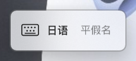
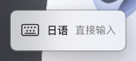
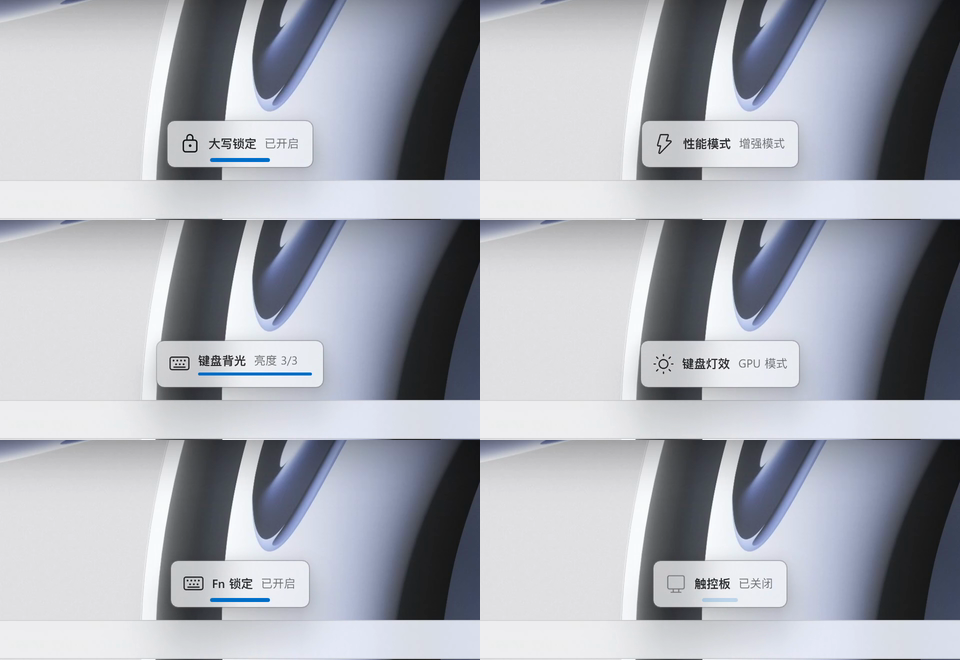
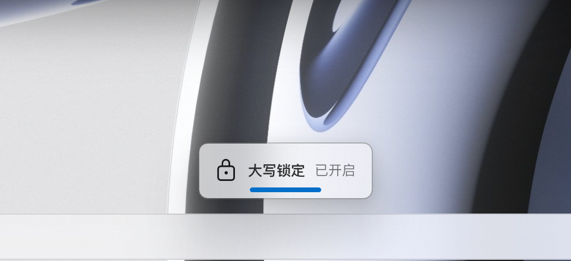
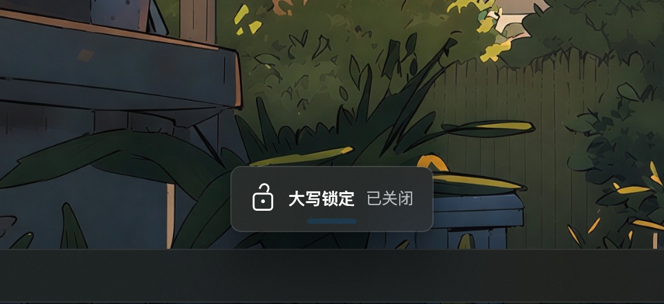
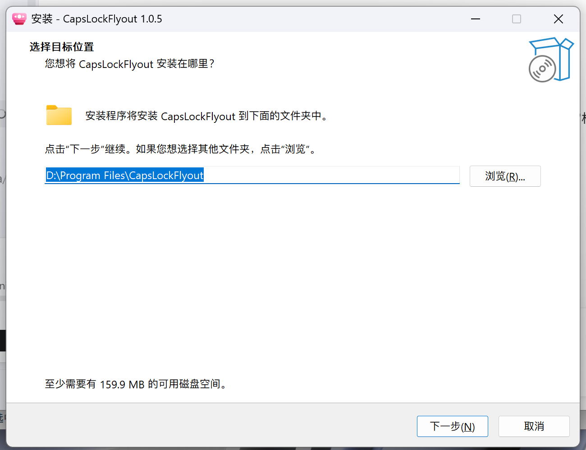
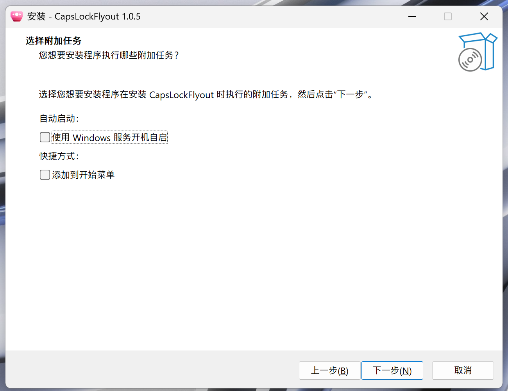
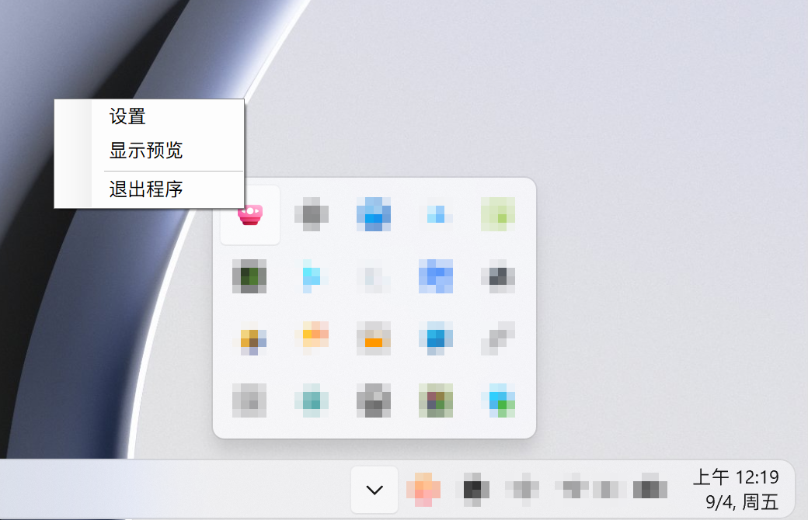

<div align="center">

# CapsLockFlyout

**输入法、大写锁定与 G-Helper 状态，统一显示在 Windows 11 风格浮窗中**

Windows 11 x64 · 中文界面 · 当前版本 1.1.0

[下载正式版](https://github.com/mianhuamu1109/CapsLockFlyout/releases/latest) · [输入法显示](#输入法显示) · [安装说明](#安装) · [更新说明](RELEASE_NOTES.md)


</div>

CapsLockFlyout 用统一的 Windows 11 原生风格展示输入法、大写锁定和 G-Helper 硬件状态。系统音量、亮度浮窗保持不变；本程序不接管输入法，也不代替 G-Helper 控制硬件。

## 输入法显示

**1.1 新增：不仅知道正在使用哪种语言，也知道当前是什么输入模式。**

| 输入法名称 | 可显示的模式 |
| --- | --- |
| 汉语 | 中文模式、英语模式 |
| 英语 | 直接输入 |
| 日语 | 平假名、片假名、直接输入 |

<table>
  <tr>
    <td></td>
    <td></td>
    <td></td>
  </tr>
  <tr>
    <td align="center">平假名</td>
    <td align="center">片假名</td>
    <td align="center">直接输入</td>
  </tr>
</table>

三张图来自 1.1.0 真实运行画面，展示同一固定宽度的浮窗，不是模式切换动画录屏。

- **读取实际状态**：每 120 ms 在后台查询前台应用的输入法状态，不用按键次数预测结果，不修改输入法状态。
- **布局不跳动**：浮窗宽度固定，中间统一显示“汉语 / 英语 / 日语”，右侧模式名在固定区域居中；语言名和模式名分别使用文字过渡动画。
- **有变化才提示**：启动时静默读取当前状态；中文 Shift 切换、日语组合键或其他方式引起的实际模式变化，都会在读取到后显示。状态不变的 Shift 不会额外弹窗。
- **无需额外组件**：输入法功能不要求安装 G-Helper 或 Windhawk。查询方法参考 Windhawk 脚本，显示仍由本程序完成。

### 使用边界

- 持续按住 Win 并用 Space 选择输入法时，系统面板的高亮项可能尚未生效。本程序显示的是前台应用已提交的状态，不跟随未提交的选中项预测；在本机验证中，松开 Win 后更新。
- 日语的全角与半角片假名共用“片假名”名称；不展示所有 IME 子模式。
- 不同应用或第三方输入法对查询接口的支持不同，可能返回未知或滞后状态。目前验证覆盖本机 Microsoft 输入法与独立 WinForms 编辑器，不代表所有应用均已兼容。
- 日语输入法下抑制大写锁定浮窗，避免 `Ctrl / Alt / Shift + Caps Lock` 切换模式时混入锁定提示。

实现细节见 [输入法查询说明](IME-IMPLEMENTATION.md)，已完成的检查见 [验证记录](VALIDATION-1.1.md)。

## 主要特点



- **接近系统原生观感**：48 DIP 高度、自适应宽度、圆角、亚克力材料、DWM 描边与阴影。
- **完整窗口动画**：浮窗连同材料和阴影整体滑入、滑出，动画位置以 120 Hz 更新。
- **G-Helper 快捷反馈**：对常用 G-Helper 快捷键先预测、后校准，避免等原 OSD 消失后才出现；此机制与输入法的实际状态查询相互独立。
- **二分状态更醒目**：大写锁定、Fn 锁定、麦克风、触控板等带状态条与图标动画。
- **适配自动隐藏任务栏**：每次出现和动画过程中都会重新读取任务栏边界，可配合 Windhawk。
- **自动跟随主题**：支持 Windows 浅色与深色模式；关闭透明效果时自动使用对应实色背景。
- **托盘驻留**：输入法每 120 ms 后台检查一次，无变化不刷新浮窗；120 Hz 位置更新计时器仅在浮窗可见期间工作。120 Hz 是更新目标，并不保证所有屏幕都能呈现 120 fps。

## 支持的状态

| 类别 | 状态提示 |
| --- | --- |
| Windows | 大写锁定开启/关闭、汉语/英语/日语输入法及模式 |
| 性能与显卡 | 性能模式、GPU 模式 |
| 显示 | 刷新率、屏幕响应加速、屏幕色彩模式、Mini LED |
| 键盘与输入 | 键盘背光、键盘灯效、Fn 锁定、触控板、麦克风 |
| 设备扩展 | AniMe Matrix、Slash 灯效、ScreenPad |
| 电源 | 接入电源、使用电池 |

大写锁定与输入法显示可独立使用，无需 G-Helper。硬件相关提示依赖 G-Helper 的集成与设备支持；实际可用项目取决于电脑型号和 G-Helper 提供的配置。

## 状态动画


大写锁定沿用锁扣开合动画。Fn 锁定、麦克风、触控板、屏幕响应加速、Mini LED 和电源状态使用相同节奏的状态条、明暗、缩放和回弹反馈。

## 任务栏自适应


浮窗不会只按系统工作区推测位置，而会读取任务栏当前的真实窗口边界。任务栏显示、隐藏或在动画中移动时，浮窗都会同步调整停靠点。

## 浅色与深色模式

<table>
  <tr>
    <td width="50%"></td>
    <td width="50%"></td>
  </tr>
  <tr>
    <td align="center">浅色模式</td>
    <td align="center">深色模式</td>
  </tr>
</table>

## 安装

1. 前往 [Releases](https://github.com/mianhuamu1109/CapsLockFlyout/releases/latest)，确认版本号，下载 `CapsLockFlyout-Setup.exe`。
2. 运行安装器并选择安装位置。
3. 按需勾选“使用 Windows 服务开机自启”和“添加到开始菜单”。
4. 安装完成后启动 CapsLockFlyout。

<table>
  <tr>
    <td width="50%"></td>
    <td width="50%"></td>
  </tr>
  <tr>
    <td align="center">安装位置可自定义</td>
    <td align="center">自启与开始菜单均可选</td>
  </tr>
</table>

安装器示意图沿用 1.0.5，窗口中的版本号不代表 1.1.0；安装位置、自启与开始菜单选项保持一致。

正式安装包包含 x64 .NET 运行时，不需要另行安装 .NET。程序自身产生的日志位于安装目录的 `Data` 子目录。Windows 的服务登记、开始菜单快捷方式、安装临时文件等仍由系统管理，因此不承诺系统盘完全零写入。

从 1.0.5 升级时，先从托盘退出旧程序，再将新版安装到原目录。不要同时运行两版。具体发行文件及校验值以该次 Release 附件为准。

> 当前安装包未使用代码签名证书，Windows 可能显示“未知发布者”或 SmartScreen 提示。请只从本项目 Releases 下载，并核对随版本提供的 SHA-256 校验值。

## 与 G-Helper 配合

- CapsLockFlyout 会把 G-Helper 的 `disable_osd` 设为 `1`，避免两套 OSD 重复显示。
- G-Helper 只在启动时读取该选项，因此首次运行 CapsLockFlyout 后建议重启一次 G-Helper。
- 程序读取 G-Helper 的现有配置与日志来识别状态，不会代替 G-Helper 控制硬件。
- 锁屏、休眠和解锁期间会暂停提示；回到桌面后只重建状态基线，不会把所有状态逐个弹出。

## 托盘与自启动



双击托盘图标可打开设置；右键可选择“设置”“显示预览”或“退出程序”。开机自启使用 Windows 服务，在用户登录或解锁后启动当前用户会话中的托盘程序。

## 系统要求

- Windows 11 64 位，版本 22000 或更高。
- G-Helper：仅在需要华硕设备状态提示时必需。
- 亚克力效果需要启用 Windows“透明效果”；关闭后会自动使用系统同色实心背景。

## 自行构建

需要 .NET 10 SDK。主程序只编译精简后的浮窗核心，不依赖第三方 NuGet 包：

```powershell
dotnet build .\FluentFlyout-2.14.0\FluentFlyout-2.14.0\FluentFlyoutWPF\FluentFlyout.csproj -c Release
```

自包含运行包（含 .NET 运行时）：

```powershell
.\Build-1.1.ps1 -SelfContained
```

输出位于 `artifacts/package-win-x64`；运行时必须保留整个目录，不能只取出 EXE。安装 Inno Setup 后运行 `Build-Installer.ps1`，可在独立目录发布并构建安装包，不覆盖正在运行的运行包。安装器、校验文件输出到 `artifacts/installer`。完整发布流程见 [发布检查清单](PUBLISHING.md)。

## 反馈问题

在 [Issues](https://github.com/mianhuamu1109/CapsLockFlyout/issues) 中提供 Windows 版本、程序版本、输入法名称、出现问题的应用及复现步骤。输入法问题请同时说明系统任务栏显示的实际模式。截图请避开私人文本；不要上传包含个人信息的完整 G-Helper 日志。

## 项目来源与许可

本项目基于 [FluentFlyout 2.14.0](https://github.com/unchihugo/FluentFlyout) 精简和修改，属于独立的社区修改版，并非 FluentFlyout 或 G-Helper 官方版本。输入法查询参考 `keyboard-ime-fluent-indicator-v2.wh.cpp`（MIT），浮窗仍使用本项目界面。项目依照 [GNU GPL v3](LICENSE) 发布，修改与来源说明见 [NOTICE.md](NOTICE.md)。

